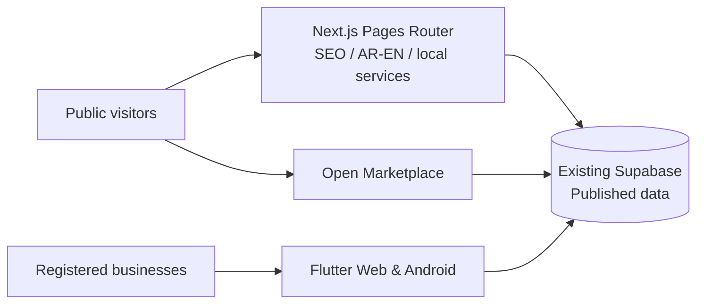

<div align="center">

# 🏗️ بيت الريف | Biet Al Reef
### منصة الأعمال والبناء والخدمات في دولة الإمارات
**UAE Construction, Business & Local Services Platform**

[](https://bietalreef.ae)
[](https://bietalreef-platform-staging.bietalreef.workers.dev)
[](https://nextjs.org)

[المنصة](https://bietalreef.ae) · [السوق المفتوح](https://app.bietalreef.ae) · [تطبيق المتصفح](https://providers.bietalreef.ae) · [Android](https://play.google.com/store/apps/details?id=ae.bietalreef.app)

</div>

---

## 🇦🇪 الرؤية | Mission

**بيت الريف** منظومة لاكتشاف الأعمال والخدمات وربط العملاء بالشركات والمؤسسات والاستشاريين والمقاولين والورش والحرفيين وموردي مواد البناء في دولة الإمارات. تمثل المنصة العامة طبقة الاكتشاف والفهرسة، بينما السوق المفتوح وتطبيق الويب/أندرويد قنوات مستقلة لنشر العناصر والتفاعل وإدارة الأعمال وفق الصلاحيات.

**Biet Al Reef** helps people discover qualified businesses and services across the UAE. The public platform, marketplace and Flutter application are distinct products backed by the existing Supabase data and publication rules.

### القطاعات | Sectors

| العربية | English |
| --- | --- |
| الشركات والمؤسسات | Companies & Establishments |
| الاستشاريون | Consultants |
| المقاولون | Contractors |
| الورش والحرفيون | Workshops & Craftspeople |
| مواد البناء والموردون | Building Materials & Suppliers |

These are **presentation labels**, not renamed database entities. Existing URLs, contracts and identifiers must remain stable.

## 🧭 Project boundaries

| Surface | Owner / Technology | Address |
| --- | --- | --- |
| **Public platform** | **This repo** · Next.js Pages Router · OpenNext stage | [Live](https://bietalreef.ae) |
| **Open marketplace** | Separate React repository | [Marketplace](https://app.bietalreef.ae) |
| **Web & Android** | Separate Flutter repository | [Web](https://providers.bietalreef.ae) · [Android](https://play.google.com/store/apps/details?id=ae.bietalreef.app) |



## ☁️ Cloudflare migration

- **Legacy migration source (READ-ONLY / EXCLUDED):** `bietalreef/bietalreef-landing-new`. Do not commit, deploy, build, or restore its assets to production.
- **This independent repository:** `bietalreef/bietalreef-platform-cloudflare`.
- **Current production:** `https://bietalreef.ae` is mapped in Cloudflare to the existing Worker `bietalreef-platform-staging` (despite its historical name). Do not mistake the worker name for an isolated staging environment.
- **Pages Router retained**; Next.js 15.5.27 + OpenNext 1.20.11 + Wrangler 4.149.0; Supabase is the single data source.
- **No additional domain cutover.** Production routing is already live on Cloudflare. Do not modify DNS or deploy over `bietalreef.ae` from a test or branch.
- **SEO staging protected:** `workers.dev` responses use `X-Robots-Tag: noindex`; staging writes are blocked.
- A successful upload does **not** replace browser smoke tests, runtime API checks, cache/ISR validation or SEO parity. The production cutover requires separate approval.

See [staging notes](docs/CLOUDFLARE_STAGING.md) and [migration acceptance checklist](https://github.com/bietalreef/bietalreef-platform-cloudflare/issues/1).

### Development and quality gates

```bash
pnpm install --frozen-lockfile
pnpm audit:site
pnpm test:local-services
pnpm test:local-growth
pnpm build:cloudflare
pnpm exec wrangler deploy --config wrangler.jsonc
```

The Cloudflare deployment must remain manual/guarded until review. Do not run live-account mutations in preview.

## 🔎 Index existing pages first

Prioritize **already indexed** Arabic and English pages on `bietalreef.ae`, especially the real Al Ain cleaning-service pilot. Capture Search Console baselines, test SEO/runtime/HTML on staging, then release only eligible reviewed changes to production. Only changed, indexable **production** URLs may be considered for URL Inspection or sitemap updates. **Never submit staging URLs for indexing.**

[Release-by-release indexing gate](https://github.com/bietalreef/bietalreef-platform-cloudflare/issues/2).

## 🔐 Security and collaboration

- Do not commit credentials, real customer information, private plans, production tokens or raw uploads.
- Preserve Supabase RLS, RPC and channel review contracts; least privilege for external contributors.
- Use separate branches, reviewed pull requests, CI security/quality tests and rollback before release.
- Report security issues **privately** to [weyaakai@bietalreef.ae](mailto:weyaakai@bietalreef.ae), not in public issues.
- Build/hosting/deployment claims must be verified with version evidence, not decorative badges alone.

---

<div align="center">**Biet Al Reef • Built for discoverability, interoperability and responsible engineering**</div>

## Deployment freeze — company-data gate (2026-10-24)

- Production is `https://bietalreef.ae` on Cloudflare Worker `bietalreef-platform-staging` (historical name only).
- `bietalreef-landing-new` is legacy migration input only: read-only; never build, update, publish, or source live releases from it.
- Hold this PageSpeed/security work on a draft PR; do not merge or publish until company data quality and channel review are approved by the owner.
- No Search Console submission, company profile publication, notification modification, Supabase data mutation, DNS reassignment or alternate parallel stack is authorized under this task.
- Before approved production release, verify desktop/mobile visual parity, user consent behavior, OAuth callback, structured data, sitemap, WAF and release rollback.
